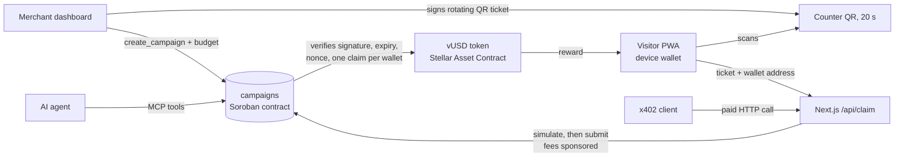

# nata

**Pay-per-visit campaigns on Stellar.** Any place (restaurant, café, shop, event booth, museum) locks a stablecoin budget in a Soroban contract that **pays only when a real visit is proven at the counter**. Visitors get instant cashback with no gas and no XLM. On testnet the token is the team-issued `vUSD` (a Stellar Asset Contract); the contract accepts any SEP-41 token per campaign, but USDC has not been tested. Passkey wallets are in the code but not deployed or enabled, so today visitors use a device wallet kept in the browser (see Known limitations).

> Built during HackMeridian (Lisbon, Oct 25–26, 2026). Track: **Genesis** + **Stellar Composed**. Network: **Stellar Testnet**.

| | |
|---|---|
| Live app | `TODO: https://<deployment>.vercel.app` |
| Demo video | `TODO: <video URL>` |
| Docs | [docs/README.md](docs/README.md), the in-app `/docs` page (EN/PT/ES), `/llms.txt` |
| Pitch deck | [docs/nata-pitch-deck-hackmeridian.pptx](docs/nata-pitch-deck-hackmeridian.pptx) |
| Architecture | [ARCHITECTURE.md](ARCHITECTURE.md) |
| Campaigns contract (testnet) | [`CBLE7UFHEZT7YCWABJN5JCH5V7O4BVUWRNCPYZ5HVTUKDGV3OIAVKSXV`](https://stellar.expert/explorer/testnet/contract/CBLE7UFHEZT7YCWABJN5JCH5V7O4BVUWRNCPYZ5HVTUKDGV3OIAVKSXV) |

## The problem

Local marketing pays for impressions and clicks, but nobody can prove that someone actually walked through the door. Loyalty programs are locked inside a single shop, and card cashback takes days and costs fees. Small merchants and event organizers end up paying for reach they cannot measure.

## The solution

1. A **merchant** creates a campaign ("2 vUSD per visit, 100 vUSD budget"). The budget is escrowed in the `campaigns` Soroban contract.
2. At the counter, the merchant's device shows a **rotating QR code** (new every 20 s) signed with a campaign ed25519 key.
3. A **visitor** opens the PWA, creates a device wallet (a key kept in the browser; passkey wallets are supported by the code but not deployed), scans the QR, and receives the reward in seconds. A sponsor account pays the fees (the OpenZeppelin relayer can do it instead, see below), so the visitor never needs XLM.
4. The contract verifies the signature, expiry, one-time nonce and one-claim-per-wallet rule **on-chain**. The backend has no power over the funds.

The merchant pays per proven visit, not per ad. The visitor gets the reward as a stablecoin-style token (vUSD on testnet). Spending it at other places in the network is roadmap, not built.

### Users

- **Merchants:** small local businesses and event organizers.
- **Visitors:** people moving around a city or an event, such as tourists and conference attendees.

## Quick start (60 seconds, local)

```bash
git clone https://github.com/developerfred/nata-stellar && cd nata-stellar
cargo test                                          # 12 contract tests
cd apps/web && pnpm install && cp .env.example .env.local
pnpm dev                                            # http://localhost:3000
```

`.env.example` already points at the deployed testnet contract and vUSD token, so the app runs against testnet as is. Claims need a funded `SPONSOR_SECRET` (see [Environment variables](#environment-variables)); the read-only pages work without it. The one-minute judge flow without installing anything is under [Demo instructions](#demo-instructions) once the live URL is filled in.

## Architecture



Details: [ARCHITECTURE.md](ARCHITECTURE.md).

## Why Stellar

- **Soroban escrow:** the budget is locked in a contract and the visit rules (signature, expiry, single-use nonce, one claim per wallet) run on-chain, so the backend cannot move funds.
- **Stellar Asset Contract token:** rewards are a SEP-41 token (vUSD on testnet); the contract takes any SEP-41 token per campaign.
- **Fee sponsorship:** the server (or the OpenZeppelin relayer) pays fees, so a visitor needs no XLM; trustlines are opened with a fee-bumped transaction.
- **x402:** an HTTP paywall on Stellar for premium campaign data.
- **MCP:** an MCP server and Claude skill let agents create and manage testnet campaigns.

## Repository layout

```
contracts/campaigns   Soroban escrow + proof-of-visit contract (Rust)
apps/web              Visitor PWA + merchant dashboard (Next.js)
packages/mcp          MCP server so AI agents can create and manage campaigns
skills/nata           Claude skill that teaches an agent to use that MCP server
docs/                 Project documentation (index: docs/README.md), build plan, pitch deck, submission notes; x402 demo in docs/X402.md
ARCHITECTURE.md       How Stellar is used: assets, contract IDs, wallet, relayer, RPC
```

## Setup

### Prerequisites

- Rust (stable) with the `wasm32v1-none` target, and the [Stellar CLI](https://developers.stellar.org/docs/tools/cli)
- Node.js 20+ and pnpm 10

### 1. Contract

```bash
cargo test                                   # unit tests (12 cases)
stellar contract build                       # builds target/wasm32v1-none/release/campaigns.wasm

stellar keys generate deployer --network testnet --fund
stellar contract deploy \
  --wasm target/wasm32v1-none/release/campaigns.wasm \
  --source deployer --network testnet
# copy the printed C… address into NEXT_PUBLIC_CAMPAIGNS_CONTRACT_ID
```

### 2. Web app

```bash
cd apps/web
pnpm install
cp .env.example .env.local     # then fill in the variables below
pnpm dev                       # http://localhost:3000
```

### Environment variables

| Variable | Scope | Description | Default |
|---|---|---|---|
| `NEXT_PUBLIC_STELLAR_RPC_URL` | client | Soroban RPC endpoint | `https://soroban-testnet.stellar.org` |
| `NEXT_PUBLIC_STELLAR_NETWORK_PASSPHRASE` | client | Network passphrase | `Test SDF Network ; September 2015` |
| `NEXT_PUBLIC_CAMPAIGNS_CONTRACT_ID` | client | Deployed `campaigns` contract (`C…`) | none, required |
| `NEXT_PUBLIC_EXPLORER_URL` | client | Explorer base URL for transaction links | `https://stellar.expert/explorer/testnet` |
| `NEXT_PUBLIC_TOKEN_CONTRACT_ID` | client | Token (SAC) used for budgets and rewards | none, required |
| `NEXT_PUBLIC_TOKEN_SYMBOL` | client | Token symbol shown in the UI (set `vUSD` for the testnet demo) | `USDC` (code default) |
| `NEXT_PUBLIC_TOKEN_ISSUER` | client | Issuer (`G…`) of the classic asset behind the token, used for the sponsored trustline of device wallets | none |
| `NEXT_PUBLIC_FRIENDBOT_URL` | client | Friendbot used to open device wallets and merchant accounts on testnet | `https://friendbot.stellar.org` |
| `NEXT_PUBLIC_WALLET_WASM_HASH` | client | Passkey smart wallet WASM hash; empty means device wallets (the factory is not deployed, so leave it empty) | none |
| `RELAYER_URL` | server | Fee-sponsoring relayer base URL | none (optional) |
| `RELAYER_API_KEY` | server | Relayer API key. Never exposed to the browser | none (optional) |
| `SPONSOR_SECRET` | server | Sponsor account (`S…`): pays fees when no relayer is configured and signs fee bumps for trustlines | none |
| `UPSTASH_REDIS_REST_URL` / `UPSTASH_REDIS_REST_TOKEN` | server | Shared rate-limit store (Vercel KV works too). Without it limits are per serverless instance | none |

> Set either the relayer pair or `SPONSOR_SECRET`. Never commit `.env.local`.

## vUSD faucet

`/faucet` (and `POST /api/faucet` with `{"address":"G…"}`) mints 100 test vUSD from the issuer key in the server-only `FAUCET_SECRET`. It is vUSD-specific: it only runs when `FAUCET_SECRET` is the secret of `NEXT_PUBLIC_TOKEN_ISSUER`, limits 3 per address and 10 per IP per UTC day (20000 vUSD per day in total), and on Vercel it refuses to run without the Upstash / Vercel KV store. A `G…` address needs the vUSD trustline first. `FAUCET_SECRET` can mint without limit: use a dedicated testnet issuer.

## x402 paid endpoint

`GET /api/x402/campaigns-premium` is an [x402](https://developers.stellar.org/docs/build/agentic-payments/x402) paywall on Stellar: `402` with the price, then the data after a signed vUSD payment (default 0.01). It stays off (503) until `X402_PAY_TO` is set. The paid round trip (0.01 vUSD) was verified live on testnet; see [docs/X402.md](docs/X402.md).

## MCP server for agents

`packages/mcp` is an [MCP](https://modelcontextprotocol.io) server (stdio) that lets an AI agent create and manage nata campaigns on **testnet**: `list_active_campaigns`, `get_campaign`, `get_claims`, `create_campaign`, `close_campaign`, `get_agent_account` and `request_faucet`. It reuses the web app's contract client, so encoding stays in sync.

```bash
cd packages/mcp && npm install && npm run build

claude mcp add nata \
  -e NATA_AGENT_SECRET=<testnet S... secret of the agent account> \
  -e NATA_CAMPAIGNS_CONTRACT_ID=CBLE7UFHEZT7YCWABJN5JCH5V7O4BVUWRNCPYZ5HVTUKDGV3OIAVKSXV \
  -e NATA_TOKEN_CONTRACT_ID=CBR455EYJZ54MTAOGRKB6M2GCNFLENMVUOPEKXXDWVPODEZLRW7V2PRD \
  -e NATA_TOKEN_SYMBOL=vUSD \
  -- node "$(pwd)/dist/index.js"
```

Safety: testnet only (other networks are refused), keys come from the environment and are never logged, budgets are capped per call (`NATA_MAX_BUDGET_PER_CALL`, default 100) and per session (`NATA_MAX_TOTAL_BUDGET`, default 500), and `dry_run` (or `NATA_DRY_RUN=true`) previews any write. Without `NATA_AGENT_SECRET` the server is read-only. `request_faucet` calls the web app's vUSD faucet when `NATA_FAUCET_URL` is set. All variables are in [`packages/mcp/.env.example`](packages/mcp/.env.example); run the tests with `npm test`.

The skill in [`skills/nata`](skills/nata/SKILL.md) tells an agent when and how to use these tools. Copy it to `~/.claude/skills/nata` (or `.claude/skills/nata` in a project) to enable it.

## Demo instructions

### Fastest path for judges (about 1 minute)

1. Open the live app on your phone: `TODO: live URL`.
2. Tap **Create wallet** (a device wallet; passkey wallets are not deployed), then get test vUSD from `/faucet`.
3. Scan the campaign QR below (or on the pitch deck) with the in-app scanner.
4. You receive the reward in a few seconds. Tap the link to see the transaction on stellar.expert.

`TODO: demo campaign QR image (docs/demo-qr.png)`

### Full flow

1. **Merchant:** open `/merchant`, register a place, create a campaign (reward, budget, window), and open **Counter mode** to show the rotating QR.
2. **Visitor:** scan the QR and claim. Balance and history update.
3. **Security checks:** replay an old QR, or claim twice with the same wallet. The contract rejects both (there is no transaction to link: see the refused-claim row below).
4. **Merchant:** check the dashboard for visits, cost per visit and remaining budget, then close the campaign to recover unspent funds.

### Testnet transaction evidence

| Action | Transaction |
|---|---|
| `create_campaign` | [a8746e3a…2fec](https://stellar.expert/explorer/testnet/tx/a8746e3a8524e9a92dc0ab21d0ce11f04d4c5ff48ea7b85a366817fc95322fec) |
| `claim` (accepted, 2 vUSD) | [82f51bda…b46e](https://stellar.expert/explorer/testnet/tx/82f51bda8bd34273881e0eb55c1b0c9316e0232bd8f963a44d76e472e327b46e) |
| `claim` (refused: reused QR, second visit) | No transaction exists, by design. `/api/claim` simulates the call first (`prepareTransaction` in `apps/web/app/api/claim/route.ts`), so the contract's `NonceUsed` / `AlreadyClaimed` errors surface as `This QR code was already used` / `You already collected this reward.` before anything is submitted or any fee is spent. Evidence: the `reused QR rejected`, `second visit rejected` and `forged ticket rejected` PASS lines printed by `scripts/e2e-testnet.sh`, and the contract tests in `contracts/campaigns/src/test.rs` |
| `close_campaign` (refund, from the e2e script run) | [d658aeb3…a592](https://stellar.expert/explorer/testnet/tx/d658aeb3a14b5971b0574cd33860d3b562cf4aaf028ea06e9f48dd97a12fa592) |
| `claim` through the OpenZeppelin relayer (testnet) | [9f181f3f…b368f3](https://stellar.expert/explorer/testnet/tx/9f181f3f8d17b936ddb2404628c72f3a958b8fcc19ffcc95649b6c8fafb368f3) |
| `close_campaign` through the OpenZeppelin relayer (testnet) | [51fec925…179514](https://stellar.expert/explorer/testnet/tx/51fec925d7e43d008077c41f0f92f59369f4d44a1528e91f1ab1a8c8c3179514) |
| x402 paid call (0.01 vUSD, settled by the facilitator) | [aabd9305…bc9b0be](https://stellar.expert/explorer/testnet/tx/aabd9305ba044c092ac2b799d2e18c875b00742be6b4fd6ba6e87f447bc9b0be) |

Deployed on Stellar Testnet: token (SAC of `vUSD`) `CBR455EYJZ54MTAOGRKB6M2GCNFLENMVUOPEKXXDWVPODEZLRW7V2PRD`, issuer `GDCSTIPNL2YTPNEYZWFVMSEYOW5SEFC6FFWU2CSIVS67CHCV34YS6B26`, demo campaign id `0` (2 vUSD per visit, 100 vUSD budget, 50 claims max). Contract [deploy tx](https://stellar.expert/explorer/testnet/tx/d6032e522576e42e8c2fdb20a6f35771d9bcb15230f277925b6ff85715404bb3).

## Automated end-to-end check (testnet)

```bash
pnpm --dir apps/web dev &                       # optional: with the app running, claims go through /api/claim
CAMPAIGNS_ID=<C… address> scripts/e2e-testnet.sh   # omit CAMPAIGNS_ID to deploy a fresh contract
```

The script funds throwaway testnet accounts, issues `vUSD`, creates a campaign, signs counter tickets, and checks that a valid claim pays, a reused QR, a second visit and a forged signature are refused, and that `close_campaign` refunds the merchant. It needs `stellar` (CLI 25.2 or newer), `node` and `curl`.

### Fee sponsorship with the OpenZeppelin relayer

By default the server pays fees from `SPONSOR_SECRET`. To use the relayer instead, generate a testnet API key at <https://channels.openzeppelin.com/testnet/gen> and set, in `apps/web/.env.local`:

```
RELAYER_URL=https://channels.openzeppelin.com/testnet
RELAYER_API_KEY=<your key>
```

When both are set, `/api/claim` and `/api/wallet` submit through the relayer and `SPONSOR_SECRET` is not needed. Passkey wallets also need `NEXT_PUBLIC_WALLET_WASM_HASH`. The relayer path was verified live on testnet (9/9 checks, see the evidence table and [docs/VERIFICATION.md](docs/VERIFICATION.md)).

## Security model

| Attack | Mitigation |
|---|---|
| Photo of the QR shared with friends | QR expires in 20–30 s; the nonce is single-use on-chain |
| Same person claiming repeatedly | One claim per wallet per campaign, enforced by the contract |
| Many wallets (sybil) | Relayer rate limits, per-campaign `max_claims`, short ticket TTL. Roadmap: proof of humanity |
| Fake merchant signing visits for themselves | They only spend their own budget, so there is no incentive |
| Malicious backend | Cannot move funds. Rules live in the contract, and rewards can only go to the bound visitor address |

## What we built during HackMeridian

Everything was built in the event window; times below are UTC commit times from the git history (`git log --format='%ad %s' --date=iso`).

| When (2026) | Milestone |
|---|---|
| Oct 25, 18:26 | Repository initialized (first commit); build plan |
| Oct 25, 18:30 | `campaigns` Soroban contract with merchant-signed proof of visit, then its tests |
| Oct 25, 18:39 | Web app: chain client, claim/wallet/balance API routes, visitor, scan and merchant counter screens |
| Oct 25, 20:08 | Contract and token deployed to testnet; evidence recorded |
| Oct 25, 22:25 | Testnet end-to-end script (`scripts/e2e-testnet.sh`) |
| Oct 25, 22:51 to 23:13 | Audit fixes (PRs #1, #2), EN/PT/ES UI and onboarding, sponsored trustline, vUSD faucet (PR #3), MCP server and Claude skill (PR #5) |
| Oct 25, 23:31 to 23:42 | x402 paywalled endpoint (PR #9) |
| Oct 25, 23:46 | Azulejo design system and three.js hero (PR #10) |
| Oct 25, 23:51 | Docs and `/docs` page with agent endpoints (PR #6) |
| Oct 26 | Pitch deck corrections, security policy, CI, market and innovation notes |

At the last count the history had 60 commits and 12 pull requests. Prior work: none (see below).

## Roadmap

Not built yet; listed in rough priority order.

1. Public deployment and demo video (tracked in [docs/SUBMISSION.md](docs/SUBMISSION.md)).
2. Passkey wallets: deploy the factory and WebAuthn verifier.
3. Real stablecoin (USDC/EURC) end to end, with a multi-token UI.
4. Anti-sybil proofs and optional geofencing.
5. Spending rewards across the merchant network; cash-out through an anchor.
6. Merchant pilot and mainnet after a security review.

Market and ecosystem plan: [docs/MARKET.md](docs/MARKET.md). How nata differs from loyalty apps, cashback and QR coupons: [docs/INNOVATION.md](docs/INNOVATION.md).

## Out of scope for this MVP

Mainnet, bank cash-out via an anchor, GPS geofencing, strong anti-sybil proofs, and a security audit. These are on the roadmap.

## Prior work disclosure

None. Everything in this repository was built during HackMeridian; see the dated commit history.

## Known limitations

- Passkey smart wallets (Face ID / Touch ID): the code path exists (`passkey-kit`), but the factory and WebAuthn verifier are not deployed and `NEXT_PUBLIC_WALLET_WASM_HASH` is empty, so the feature is off. Visitors use a device wallet kept in `localStorage`; clearing site data loses it.
- One token per deployment in the UI (the contract accepts a token per campaign). The faucet and trustline sponsorship are vUSD-specific.
- x402 and the relayer were verified on testnet only. The x402 paid call settled once with vUSD through the facilitator; there is no mainnet or USDC test.
- `FAUCET_SECRET` is the vUSD issuer key: dedicated testnet key, never reused.
- Testnet only, no external audit.

Open placeholders (live URL, video URL, demo QR) are tracked in [docs/SUBMISSION.md](docs/SUBMISSION.md).

## Contributing and security

[CONTRIBUTING.md](CONTRIBUTING.md) and [SECURITY.md](SECURITY.md).

## License

[Apache-2.0](LICENSE). Copyright 2026 codingsh, see [NOTICE](NOTICE).
